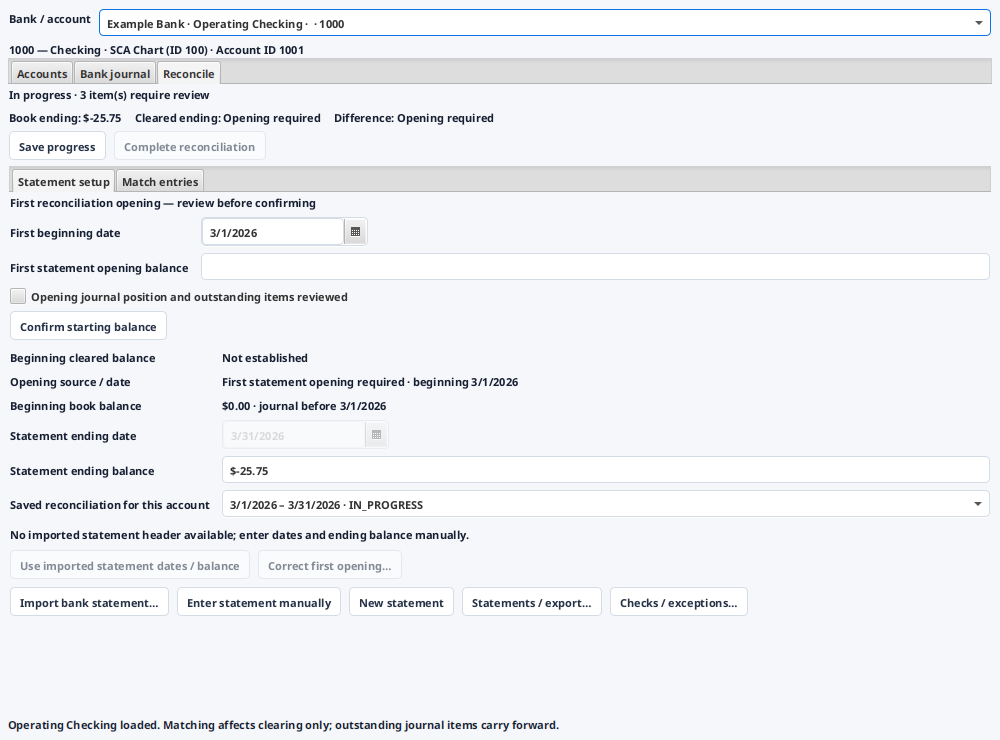
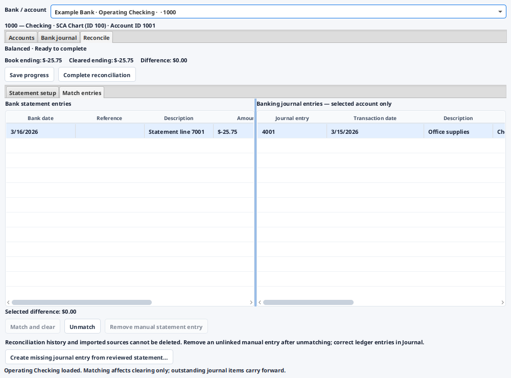

# SCA Ledger User Manual

**First working draft for review — 21 November 2026**

For volunteer bookkeepers, company managers and database administrators using Nonprofit Accounting (SCA-Jakarta).

This manual describes the current application, including Banking's **Statement setup**, **Match entries** and inline manual statement editor. Your company supplies its own chart, accounting policies, evidence, fiscal dates and reporting requirements. Examples illustrate use of the application; they are not transactions to enter in your organization's books.

Use the Contents links or Word's Navigation pane to find a task. Bold text identifies an on-screen label. An arrow means “open this, then choose that”: **Banking → Reconcile → Statement setup**.

## Contents

- [Start here](#start-here)
- [Understand the records](#understand-the-records)
- [Create, open and switch databases](#create-open-and-switch-databases)
- [Back up and restore a database](#back-up-and-restore-a-database)
- [Set up a company](#set-up-a-company)
- [Manage a company and its master records](#manage-a-company-and-its-master-records)
- [Manage users, roles and preferences](#manage-users-roles-and-preferences)
- [Enter and correct journal transactions](#enter-and-correct-journal-transactions)
- [Import files](#import-files)
- [Export files and choose the right format](#export-files-and-choose-the-right-format)
- [Banking and reconciliation](#banking-and-reconciliation)
- [Run, interpret and export reports](#run-interpret-and-export-reports)
- [Opening conversion and period close](#opening-conversion-and-period-close)
- [Events, budgets and Fund transfers](#events-budgets-and-fund-transfers)
- [Open items and other operating functions](#open-items-and-other-operating-functions)
- [Administrative reference and repair tools](#administrative-reference-and-repair-tools)
- [Troubleshooting](#troubleshooting)
- [Period-end and handover checklists](#period-end-and-handover-checklists)

# Start here

## Choose a starting route

| Your situation | Start with |
|---|---|
| Taking over an existing set of books | Obtain the database backup, source documents and reporting instructions; restore a separate validated copy and check the active company. |
| Establishing a new company's books | Create or select the database, create the company profile, load the intended chart and master records, and establish supported opening balances. |
| Doing routine bookkeeping | Confirm the database and company, select the accounting defaults in Period Close, enter/import transactions, reconcile banks and run reports. |
| Learning the application | Use a separate practice database. Any sample-data command belongs in that practice database. |

The application database is the saved set of books. Opening a report or choosing a company changes what you are viewing; entering and saving a transaction changes those books.

## Sign in and identify your workspace

1. Start the application using the launcher supplied with your installation.
2. Select the intended database if prompted. Existing users can use **File → Database → Select Database File…**.
3. Sign in with a user account assigned to the company you need. Enter that account's configured password. Leave Password blank only for an account that has no password configured.
4. Check the signed-in user/role and the toolbar's **Company** and **DB** labels.
5. Open **Administration → Database Transfer** when you need to verify the complete database path rather than just its filename.

**Expected result:** the correct database is connected and the intended company is active before you enter or import anything.

If you cannot select a company, ask an ADMIN to check its Active status and your company-role assignment. Repeatedly signing out and in does not repair a missing assignment or a wrong account link.

## Navigate, resize and save

Open destinations from the left navigation or **Destinations** menu. Open workspaces appear as tabs. A tab may contain named work views, such as Journal's **Entry** and **Additional Details**, or Banking's **Accounts**, **Bank journal** and **Reconcile**.

Drag a divider to give a table or editor more space. Use the local horizontal scrollbar to reach columns at the right, and the local vertical scrollbar to reach lower fields. A control's hover text can show its full label or a reason it is unavailable. Collapsing the navigation gives the work area more width.

**New** and **Save** apply to the active function. Read the current button label: **Save Entry**, **Save account details**, **Save progress** and **Save statement entry** save different records. For read-only reports, use **Run** and **Export** rather than Save.

After saving, wait for completion or an error message. Check that the record appears in its list. A message that an operation is starting is not confirmation that it finished. Correct a reported error using the retained draft, then retry. If the outcome is uncertain, check the saved list before starting a second transaction.

# Understand the records

| Term | Meaning in this application |
|---|---|
| Database | The working file containing companies, accounting records, configuration and retained history. A single database can contain more than one company. |
| Company | The bookkeeping organization whose records you are using. The active company scopes most lists, entries and reports. |
| Chart of Accounts | A named/versioned collection of accounts belonging to a company. A company can retain several charts and select one as active. |
| Account | A ledger classification such as a bank asset, receivable, liability, income or expense. Code and name help you recognize it; the application also retains its unique ID and chart. |
| Fund | A separate accounting allocation, such as a general or restricted fund. A Fund is not the same thing as a bank account. |
| Event / Activity | An activity classification used to group relevant income and expense. It is independent of Fund and Budget Category. |
| Journal transaction / entry | A complete accounting record with a date and at least two meaningful lines. Total debits equal total credits. |
| Accounting period | The company's selected period used for default dates and period-related views. Selecting it does not close the books. |
| Bank | The institution or bank identity maintained in Banking. |
| Configured bank account | A bank account linked to one specific ledger account. This link determines which journal lines appear in its bank journal and reconciliation. |
| Bank statement | The bank's transactions and balances for one account over a date range. OFX/QFX, mapped CSV or manual entry can supply bank-side records. |
| Reconciliation | The saved comparison between a bank statement and journal records for that configured bank account. |
| Cleared | A bank-account line has been matched/cleared through reconciliation. An informational date in Journal does not establish this state. |
| Opening balance | A balance brought into a period or a new set of books. A reviewed bank-statement opening and a journal book opening are separate facts. |
| Open item | A tracked receivable, payable, prepaid/deferred balance or other asset/liability with increases, reductions and a remaining balance. |
| SCLX | A business-data interchange file for one selected company. It has a different scope from a complete database backup. |

## Debits, credits and two-decimal amounts

Journal entries use **Debit** and **Credit** columns. Enter an amount on one side of a line. Each complete entry must balance, even when it has several lines or imported allocations. Journal money uses whole cents: enter no more than two decimal places; fractional cents are rejected rather than silently rounded into a saved entry.

For simple illustrations using your own appropriate accounts and the same Fund:

| Activity | Debit | Credit |
|---|---|---|
| Receive $100.00 of income into a bank account | Bank account $100.00 | Appropriate income account $100.00 |
| Pay a $50.00 expense from a bank account | Appropriate expense account $50.00 | Bank account $50.00 |
| Move $100.00 between two company bank accounts | Receiving bank account $100.00 | Paying bank account $100.00 |

These examples explain the entry structure. Choose accounts and classifications appropriate to the real transaction. Recording a receivable, liability or other tracked item may also require its supplemental details.

In **manual bank statement entry**, the amount instead uses a sign: deposits are positive and withdrawals are negative. That bank-side amount is not a replacement for a balanced journal entry.

# Create, open and switch databases

**Who:** after sign-in, database actions require ADMIN/database-administration authority.

## Create a working database

1. Choose **File → Database → Create New Database…**.
2. Choose a folder and a new database filename. The normal working-file extension is **.mv.db**.
3. Confirm the requested action and allow initialization/validation to finish.
4. Check the connected database path and review the company list.
5. Create or select your company using the company setup chapter. Complete any sign-in prompt and verify the active company.

**Expected result:** a separate database is initialized and selected. Creating a file is not the same as creating the complete chart, bank links and opening accounting records for your organization.

For practice, create a separate database. The **Create / Refresh Sample Company Data** command writes demonstration data; use it only in a database you intend for that purpose.

## Open an existing working database

1. Save or deliberately discard unfinished edits.
2. Choose **File → Database → Select Database File…**.
3. Select the intended working H2 database file, normally ending in **.mv.db**.
4. Wait for validation and any required application updates.
5. Check the path, active company, user access and a familiar Journal/report record.

A backup ZIP belongs in **Restore Database Copy…**. A SCLX file belongs in **Import**. Neither is a working H2 file to select through this command.

## If opening fails

Read and retain the actual error, including the full path. Verify that the intended file exists and that another running copy of the application is not holding it. Use **Retry / Repair Current Database** to retry the application's supported opening/update process, or select another known database.

If necessary, ask the administrator to restore a known backup into a separate copy. The opening/update process is not a general repair of incorrect accounting references. Keep the source database and backup until a replacement has been checked; use the application's recovery workflow rather than editing database internals.

# Back up and restore a database

## Make a complete backup

**Before you start:** identify the active database and choose a new destination filename. A useful name includes company/group, date and purpose, such as **group-2026-11-21-before-import.zip**. A database may contain multiple companies even if the filename names one group.

1. Open **Administration → Database Transfer**.
2. Choose **Backup Database…**. The confirmation is titled **Back Up Database**.
3. Select a new ZIP destination. The supported workflow rejects an existing destination rather than overwriting it.
4. Confirm and wait for completion.
5. Record the backup path, displayed SHA-256 identifier and company/transaction/split counts.
6. Keep the completed backup in the organization's designated backup location.

**Expected result:** a supported backup of the entire database, including its companies and database-held configuration/history. Use this for complete recovery. Keep external receipts, evidence and original import files in the organization's own document custody as well.

## Restore and validate a copy

1. In **Administration → Database Transfer**, choose **Restore Database Copy…**.
2. Select the supported backup ZIP.
3. Choose a new target database path.
4. Let restoration, application updates and validation complete.
5. Review the result, source backup identifier and displayed counts.
6. When ready, choose **Switch to Validated Copy** and confirm **Switch Database**.
7. Check the active path, company, representative Journal entries, bank accounts and reports in the restored copy.

Restoring creates a separate copy; it does not automatically overwrite or replace the active database. Keep the source backup while checking the restored result.

## Plan a handover or computer replacement

Make a fresh supported backup, give the successor the appropriate launcher/application version and backup, and have them restore a separate validated copy. Confirm company access and reports together. Transfer original statements, source files, evidence and organization-specific instructions separately. A SCLX transfer alone does not carry credentials or all database settings.

# Set up a company

**Who:** ADMIN or MANAGER for company configuration. An ADMIN manages user access and database operations.

## Create the company profile

1. Open **Administration → Company Admin**.
2. Choose **New**.
3. Enter a unique **Code** and the **Display name** users should recognize.
4. Supply **Legal name**, **Branch type**, **Parent organization / kingdom** and an informational **EIN** where applicable.
5. Set **Fiscal-year start month**, **Fiscal-year start day** and **Default currency** to the organization's actual settings.
6. Leave **Active** selected for a company that will be used.
7. Choose **Save** and verify the saved company row.
8. Select it and choose **Select Active**, or select it using the toolbar's Company control. Confirm the active company changed.

**Expected result:** the company profile exists in the selected database. A saved profile alone does not establish a complete opening ledger.

## Complete the initial setup checklist

Complete these tasks before routine bookkeeping:

1. Arrange access for the people who will work on the company.
2. Load the intended Chart of Accounts, then select its correct version as active on the **Chart of Accounts** page.
3. Review account codes, types, normal balances, posting/parent structure and Active status.
4. Establish the company's **Funds**. Add **Budget Categories** and **Events / Activities** as needed.
5. Add **Payees / Counterparties** and **Merchants** needed for actual transactions.
6. In **Banking**, create each bank identity and link each real bank account to the intended company/chart/ledger account.
7. Select the accounting defaults in **Period Close**, checking the displayed dates.
8. Enter or import the cutover accounting records and supporting open items/registers.
9. Review **Opening Conversion**, resolve differences and record acceptance when the reviewed opening position is ready.
10. Run a Trial Balance and the relevant bank/open-item reports, then make a supported backup.

Use the organization's actual starting date and reviewed balances. The application does not infer the correct opening accounting entry from a bank configuration field or a conversion acceptance.

## Load and activate the intended chart

For a new company without a chart, obtain a supported chart JSON file from the organization and use **Chart of Accounts → Import JSON…** with **CREATE_NEW_CHART**. If an approved starting chart already exists in another company, export its active chart using **Export JSON…**, select the new company and import that file as a new named/versioned chart. Review the proposed accounts and any opening values before accepting them. **Import → Preview COA CSV…** is available when the intended company already has its active target chart.

For JSON import, choose the appropriate import mode. **CREATE_NEW_CHART** creates a new named/versioned chart; other modes update/map accounts under their stated rules. Supply explicit code mappings when using **MAP_CODES**. The preview identifies the target and proposed account actions. Use **Save Imported Accounts** only after review.

After the chart is available:

1. Open **Chart of Accounts**.
2. Select the intended chart by its name/version/ID.
3. Choose **Make Active Chart** and confirm.
4. Verify that new account maintenance and applicable new choices use the intended chart.

Changing the active chart does not move old transactions or relink bank accounts. The same account code in two charts represents two different records. Review chart names and account IDs whenever a choice is ambiguous.

# Manage a company and its master records

## Update a company profile

1. Open **Administration → Company Admin**.
2. Select the saved company.
3. Edit its profile fields and choose **Save**.
4. Verify the updated company row and active-company label.

Review changes to fiscal settings and currency with the person responsible for the books, then verify report dates and presentation. Changing the default currency does not convert already-recorded amounts into another currency. Choosing a different company changes the working context; it does not combine those companies' books.

## Deactivate a company

Select the company, clear **Active** and Save. The current company and the last active company are protected from deactivation. Select another eligible company first when appropriate. Companies retain their history and are not hard-deleted.

## Maintain accounts, Funds, people and activities

Use the owning destinations: **Chart of Accounts**, **Funds**, **Budget Categories**, **Payees / Counterparties**, **Merchants**, and **Events / Activities**.

For a new record, use the page's **New** or **+ Add** action, enter its required fields and Save. For a change, select the existing record, edit its fields and Save. Verify that you edited the intended saved record rather than a new draft.

Where the page offers deactivation, clear **Active** and Save to retire a referenced record while preserving its history. Existing historical references can remain valid even when a record is no longer offered for new use. The page explains when deletion is unavailable.

Keep Fund, Event and Budget Category distinct. An Event describes an activity; a Fund describes the accounting allocation; a Budget Category describes planning/classification. None is automatically inferred from a memo.

## Set reporting defaults

In Company Admin, choose **Default opening report** and **Default export format** under Reporting defaults. Choice changes save immediately; **Save Reporting Defaults** explicitly saves the displayed choices. These affect a newly opened Report Library. File/toolbar Save on Company Admin saves the company profile.

Dates and Fund/account/asset/item filters remain the report operator's responsibility. A preferred opening report does not establish the correct reporting period.

# Manage users, roles and preferences

## Understand the fixed roles

| Role | Normal capabilities |
|---|---|
| ADMIN | Bookkeeping, company administration, user/security administration, database administration, export and presentation preferences. |
| MANAGER | Bookkeeping, company administration, export and presentation preferences. |
| ACCOUNTANT | Bookkeeping, export and presentation preferences. |
| VIEWER | Read records/reports, export and presentation preferences; no bookkeeping writes. |

Roles apply to the signed-in user's assignments for the selected company. Some actions also require an active record, a valid preview, an open period or an editable reconciliation. A role alone does not remove those conditions.

## Create a user and grant company access

**Who:** ADMIN.

1. Open **Administration → User Admin**.
2. In **Users**, use **New User**, enter Username, Display Name and Email as applicable, and choose **Save User**.
3. In **Company Assignments**, use **New Assignment** to select the Company, User, one of the fixed roles and the Start Date.
4. Choose **Save Assignment**.
5. In **Authentication**, select the user and set/change the password using **Save Password**.
6. Have the user sign in and verify the company and role shown in the workspace.

The reserved ADMIN, MANAGER, ACCOUNTANT and VIEWER identities/roles have fixed behavior. Additional role descriptions do not create new runtime permissions. ADMIN's protected assignment cannot be casually ended.

## End access

Select the appropriate active assignment and use **End Selected** or **Revoke Selected**, supplying its date and reason. End/revoke relevant assignments before deactivating a non-reserved user. Retained history is not deleted, and end/revoke dates cannot be in the future.

## Change presentation preferences

Open **Administration → Preferences**. Apply/save the company's supported presentation choices, such as date, money and theme settings. These change presentation, not account ownership or historical amounts. Table widths/order and divider positions are also remembered through the application's company-owned layout state.

## Set the accounting defaults

1. Open **Period Close**.
2. Select the accounting month and choose **Set Active Period**.
3. Inspect the resulting period dates and Open / Partially closed / Closed status.

This sets defaults used by relevant workspaces. Existing drafts and deliberately edited report dates are preserved. **Use Active Period** separately copies the period into the close dates. Neither action closes, reopens or changes a transaction's factual date.

# Enter and correct journal transactions

## Create an entry

**Before you start:** select the correct database/company, load the intended accounts and Funds, and identify the actual transaction date and evidence.

1. Open **Journal** and choose **New** to open **Entry**.
2. Enter the transaction date and a useful memo.
3. Add at least two meaningful entry lines. Choose the real account and Fund for each line.
4. Enter either Debit or Credit on each line. Include every required allocation.
5. Assign Event and Budget classifications where appropriate. Fund and Event choices are independent.
6. Open **Additional Details** for the payee, payment/reference information and other available header facts.
7. Complete any required **Supplemental Details** for tracked receivables, payables or other open items.
8. Review debit, credit and difference totals. The complete entry must balance exactly.
9. Choose **Save Entry** or the contextual toolbar/File Save.
10. Wait for completion, then inspect the saved transaction in Journal.

**Expected result:** one complete balanced transaction is saved, including its information and applicable supplemental details. Moving among Entry, Additional Details and Supplemental Details retains the same draft; it does not create separate transactions.

## References, dates and clearing

Use structured payment/check reference fields rather than putting the only check number in the memo. Individual bank lines can carry their own payment method, reference and issue/delivery facts.

Additional Details also includes **Transfer ID / Check #**, an informational statement/cleared date and an incoming check/transfer date. The transaction date remains the accounting date. These informational fields do not set the authoritative cleared flag; reconciliation maintains that state for each bank account.

Check-number uniqueness is assessed within the issuing account, including retained reversed checks. Select the intended account rather than changing a reference merely to avoid a message.

## Find and correct an entry

Search the Journal register using dates, memo, payee, reference, bank, Fund or Event. A result represents the complete transaction. If Fund and Event filters are combined, the same entry line must match both, while displayed transaction totals still include all its lines.

Double-click a transaction or use **Edit Selected**. Review its complete lines and supplemental details before saving a permitted correction. The configured correction method determines whether direct edit/delete is available or whether a reversal/replacement is required. Closed periods, reconciliations and linked lifecycle records can protect an entry.

When a closed-date error offers **View Closed Range**, use it to inspect the actual blocking range. That navigation does not reopen the period, discard the draft or retry the save. Ask an authorized operator to resolve the underlying close/correction requirement.

# Import files

## Choose the right import route

CSV is a container format, not one universal accounting layout. Choose the route matching the file's contents.

| File or source | Route | What accepting it does |
|---|---|---|
| SCLX company interchange | Import → Preview SCLX… | Imports the previewed supported business records into the chosen company, subject to mappings/conflicts and confirmation. |
| Chart-only JSON | Chart of Accounts → Import JSON… | Imports chart/account configuration using the selected mode. |
| Chart of Accounts CSV | Import → Preview COA CSV… | Saves accepted chart/account rows through the chart import workflow. |
| Bank OFX/QFX | Banking's Import bank statement… or Import → Preview Bank OFX/QFX… | Saves reviewed bank statement records for the selected configured bank account. |
| Bank's own CSV layout | Import → Preview Mapped Bank CSV… | Uses an explicit column/date/amount mapping profile to create reviewed bank records. |
| Application normalized bank CSV | Import → Preview Normalized Bank CSV… | Reads the specific normalized bank CSV 1.0 format; it is not an arbitrary bank CSV. |
| Supported SCA Exchequer worksheet CSV | Import → Import Exchequer CSV… | Builds editable proposed journal entries, then saves the reviewed complete batch. |

COA CSV preview requires the intended company to have its active Chart of Accounts first. Use the chart JSON create-new-chart route when that prerequisite is missing.

Keep the original source file. Review the target company, chart/bank identity, dates, amounts, classifications and duplicate/conflict messages before accepting any preview. A preview is not confirmation that the business records have been saved.

## Import SCLX company data

1. Select the target company and make a complete database backup.
2. Open **Import → Preview SCLX…** and select the SCLX file.
3. Review section counts, proposed operations, validation messages and their details.
4. Review required identity mappings and any conflicts with existing target records. Choose the intended retained/imported treatment only after checking the records.
5. Use **Re-preview with SCLX Choices** after changing mappings/choices, or **Re-preview Same SCLX** after repairing target records.
6. Resolve blocking errors and supply the required acknowledgments/confirmations.
7. Choose **Save Previewed SCLX Import…**, confirm and wait for the result.
8. Inspect representative imported records and reports in the target company. Keep the backup while checking them.

The reader supports SCLX 1.0, 1.2 and 1.3; unsupported future versions are blocked. Older versions carry a reduced contract. Use the preview's actual supported/unsupported record messages rather than assuming every source fact will transfer.

If the preview identifies unresolved company ownership, use **Administration → Company Ownership Diagnostics** as described later, then re-preview. Ownership repair is deliberate and restricted; it is not an automatic assignment based only on the active company.

## Import a bank statement

Start in **Banking**, select the configured bank account and open **Reconcile → Statement setup → Import bank statement…**. This supplies the account context to Import. Import can also start from the Import destination, where you must select the configured account explicitly.

1. Select the OFX/QFX, mapped CSV or normalized CSV route appropriate to the source.
2. Confirm the target bank/account and source institution/account information.
3. For mapped CSV, choose/create the profile for that bank layout and verify its date and signed-amount or debit/credit column interpretation. Use **Save CSV Profile…** if appropriate for reuse.
4. Examine original source rows, proposed bank rows, dates, signs, references and validation/duplicate messages.
5. Resolve blocking problems and choose **Save Previewed Bank Review…**.
6. Return to the same account in Banking. Review any offered imported statement dates/ending balance before using them.

QIF is not supported by this workflow. Normalized bank CSV is the application's defined 29-column versioned format; use mapped CSV for a bank's different layout.

**Expected result:** bank-side source records are available for review and reconciliation. Importing a bank statement does not by itself create balanced journal entries or mark existing entries cleared.

## Import an Exchequer worksheet CSV into Journal

1. Open **Import → Import Exchequer CSV…** and choose the supported worksheet CSV.
2. Review **Proposed Entries**. Use **Original Source and Diagnostics** to inspect source facts, including non-monetary records.
3. Use **Edit Selected** to review date, memo, payee and accounting lines.
4. Inspect source **Split 1** through **Split 4** and map their meaningful allocations to the intended account and Fund. Optional Event, Budget, Merchant and purpose remain separate choices.
5. Use **Apply Mappings to Same Source Labels** only when the other source labels should receive the same mapping.
6. Edit/delete proposed records and add/remove accounting lines as needed before committing.
7. Check every proposed transaction: its own debit-minus-credit difference must be zero and its amounts must be whole cents. Errors in different source rows cannot cancel one another.
8. Review possible similar Journal entries before acknowledging them. Use **Refresh Choices** to reload current choices while retaining the draft.
9. Choose **Commit Reviewed Entries**, or File Save for the active review, and confirm the complete batch.
10. On success, open Journal and check the listed transaction IDs. On failure, use the retained proposals and identified error to correct/retry.

Source dates are taken literally; the importer does not reject an entry merely because it is outside the quarter named on the file. The source CSV is not edited. **Back to Import** and **Resume Exchequer Review** preserve an unfinished review. Correct already-saved entries through Journal.

# Export files and choose the right format

| Output | Intended use | Scope |
|---|---|---|
| Database backup ZIP | Recovery, computer replacement or complete database handover | Complete supported database backup; may include several companies, user/security records and database-held preferences/history. |
| SCLX | Transfer supported business data for one company | Selected company, including its exported charts and supported history; excludes credentials, UI preferences and other companies. |
| Chart of Accounts JSON | Reuse or transfer a chart | Active chart/account configuration; not the complete company's books. |
| Normalized bank CSV / OFX statement export | Transfer/review supported bank statement data | Selected account/date scope and the chosen supported bank format. |
| Text, CSV, PDF or Excel report | Read, print, analyze or share results | The requested report and its parameters; not a replacement for a database backup. |
| Accounting packet ZIP | Collect the supported accounting reports and readiness context | Requested packet dates across all Funds/Events. It is separate from a native database backup. |

## Export a company to SCLX

1. Select the intended company and check its identity.
2. Choose **File → Export Active Company to SCLX…**.
3. Select a destination and complete the export.
4. If it fails, read the detailed record/account/chart information and correct the actual issue before retrying.
5. Keep the completed file and confirm that the receiving application supports the relevant SCLX records/version.

The writer emits SCLX 1.3. The selected-company export includes company-owned charts, including retained inactive charts, so referenced history can keep its real chart/account identities. It still exports only the selected company's supported business data. Use a complete database backup for full recovery, including security and preferences.

## Export a chart or bank records

For chart configuration, open **Chart of Accounts**, verify the active chart, and use **Export JSON…**. For bank records, select the account in **Banking → Reconcile → Statement setup**, then open **Statements / export…** and use **Export Bank CSV…**, **Export OFX 2.x…** or **Export QFX…** as appropriate. Review the account, date range and format before saving the file.

A report CSV, a bank CSV and a chart CSV have different purposes. Editing an exported report in a spreadsheet does not change the application ledger. Use the application's entry/import/correction workflow for changes to saved books.

# Banking and reconciliation

## Configure the bank and account link

**Before you start:** the intended company and chart/account must be available. Give each real account its own configured bank-account record, even when several accounts use the same bank.

1. Open **Banking → Accounts → Bank / account settings…**.
2. In **Banks**, create/save the institution if it is not already available.
3. In **Bank accounts**, start a new account configuration and select the bank.
4. Choose **Select existing qualifying Chart of Accounts bank account**, or use the linked-account creation option when a new appropriate account is needed.
5. Inspect the selected ledger account's full code/name, chart/version and ID. Matching codes or names alone do not prove two records are the same.
6. Enter the account's nickname, masked identifier and applicable opening/import settings. Choose its actual Active state.
7. Use the contextual **Save Bank Account** / **Update Bank Account** action and verify the configured row, linked chart/account and Active status.

The main Banking selector is shared by **Accounts**, **Bank journal** and **Reconcile**. **Accounts** shows configuration/status; **Bank journal** shows canonical journal records using that exact linked ledger account. **Reconcile** compares that account's bank and journal records.

## Understand beginning bank and book balances

The **beginning cleared balance** is the bank starting position used for this reconciliation. For the first reconciliation, supply and review it explicitly. For a later period, an eligible preceding completed reconciliation provides its closing statement balance and the source is displayed.

The **beginning book balance** is calculated from Journal before the period. It can differ from the bank opening because of outstanding checks or deposits. For example, a $1,000.00 bank opening and a previously recorded $100.00 unpresented check can coexist with a $900.00 book opening. Do not force the two opening displays to agree by inventing a new transaction.

Bank configuration opening metadata is not a second journal entry. **Confirm starting balance** records the reviewed reconciliation opening; it does not create a balancing accounting entry.

## Start a reconciliation

1. Select the correct **Bank / account** at the top of Banking.
2. Open **Reconcile → Statement setup**.
3. For a new reconciliation, use **New statement** if another saved reconciliation is loaded. To resume, choose the relevant **Saved reconciliation for this account**.
4. Before saving a new reconciliation, review any offered imported header facts and use **Use imported statement dates / balance** when they are the intended source.
5. Enter/check the bank's **Statement ending date** and **Statement ending balance**, then choose **Save progress**.
6. For a first reconciliation, enter **First beginning date** and **First statement opening balance**. Review the opening journal position and outstanding items, select the review checkbox, then choose **Confirm starting balance**.
7. For an inherited opening, check its displayed amount/date/source rather than replacing it.

**Expected result:** a saved reconciliation for that account, with a known ending target and an explicitly established opening before completion. Enter 0.00 deliberately when the reviewed opening really is zero; blank does not mean zero.

*Illustration: the full-height Statement setup form. The demonstration account and figures are synthetic; use your own bank records.*

## Enter bank statement transactions manually

1. In the saved reconciliation's **Statement setup**, choose **Enter statement manually**.
2. Use the inline form that appears in the same workspace.
3. Enter **Bank date**, **Reference / check / deposit #**, **Description**, and **Amount (+ deposit, − withdrawal)**. Use the date the transaction appears in the bank records and an amount with at most two decimal places.
4. Choose **Save statement entry**. Toolbar/File Save also targets the inline entry while that setup editor is active.
5. Wait for success. The saved entry editor closes/clears; open it again for the next bank transaction.
6. Use **Cancel entry** to discard the current unfinished manual entry.

A rejected amount/date stays available to correct. Switching accounts or saved reconciliations preserves their separate pending entries; returning restores the corresponding editor. Save or cancel the current pending entry before completing its reconciliation. The explicit **Save progress** button continues to save the reconciliation header/progress.

For a simple illustration, a beginning bank balance of $1,000.00 plus a $300.00 deposit and a $50.00 withdrawal gives an ending target of $1,250.00. Enter the deposit as +300.00 and the withdrawal as −50.00. The corresponding journal entries must also exist before those bank rows can be matched.

## Match and clear

1. Open **Reconcile → Match entries**.
2. Select a **Bank statement entry** on the left and its corresponding **Banking journal entry** on the right.
3. Inspect the identity, amount, reference and dates. The selected difference must be zero for **Match and clear** to be available.
4. Choose **Match and clear** and wait for completion.
5. Repeat for every bank statement transaction.
6. If a match is wrong, select the linked pair and use **Unmatch**, then choose the correct pair.

Matching records the bank clearing facts without changing the journal amounts. Journal and bank dates can differ. One instrument split across Funds matches/unmatches as a whole. A transfer between two banks has a separate bank item and clearing state for each account.

*Illustration: Match entries has two tables with one divider. Account selection, amounts and completion status refer to this account only.*

If a required journal entry is genuinely missing, create the correct balanced entry in Journal or use **Create missing journal entry from reviewed statement…** and complete its reviewed acceptance. Import/manual bank entry alone does not post a journal transaction. Check for an existing entry first to avoid recording the same activity twice.

## Save, complete and continue

**Save progress** retains an unfinished reconciliation. **Complete reconciliation** becomes available only when the opening is confirmed, the ending target is known, the difference is zero, all eligible statement rows are accounted for and no unresolved source errors or unfinished manual entry block completion.

Outstanding journal checks/deposits that have not reached the bank can remain unmatched and carry forward. Zero net difference alone cannot hide unresolved offsetting statement rows.

Completed history is read-only. Use **New statement** for the next period and verify the carried opening/source. To correct an eligible uncompleted first opening, use **Correct first opening…** after resolving any required existing matches. Imported sources and completed history are retained; an eligible unlinked erroneous manual statement entry can be removed with its source/audit history retained.

For multiple bank accounts, complete these steps separately for each account. Their openings, periods, outstanding items, differences and completion states do not net against one another.

## Checks and references

**Bank journal → Save banking reference** can update an eligible instrument's reference while preserving the underlying accounting lines. Use **Open complete journal entry** for ledger corrections. Cleared flag/date are read-only in Bank journal.

Open **Statement setup → Checks / exceptions…** for check review, delivery evidence, Void or Reissue. Save Review records factual review information. Age alone does not cancel a check. Void and Reissue use the governed correction workflow and retain history; reissue is not a second expense. Resolve protected/cleared entries through the appropriate reconciliation/correction process.

# Run, interpret and export reports

## Choose a report for the question

| Report | Typical question | Date basis |
|---|---|---|
| Trial Balance | What are the debit/credit account balances at the cutoff? | As of date |
| Balance Sheet | What are assets, liabilities and net assets, and how did they change? | Selected comparative range; beginning is the day before the start, ending is the end date |
| Income Statement | What income and expense occurred in the period? | Date range |
| General Ledger Detail / Transactions List | Which entries explain an account or transaction result? | Date range; available account and row-limit filters |
| Bank Account Activity | What activity is recorded for the selected bank scope? | Date range |
| Functional Expenses | How are expenses classified by function? | Date range and supported classifications/filters |
| Accounts Receivable / Accounts Payable | Which tracked amounts remain due? | As of date |
| Prepaid Expenses / Deferred Revenue / Other Assets / Other Liabilities | What remains in the tracked balances and their control reconciliation? | As of date |
| NMR Liabilities / NMR Period Movements | What designated NMR remains, or moved in the period? | As of date / date range respectively |
| Fixed Asset Register / Inventory On Hand & Valuation | What is recorded in the register or stock, and how does it tie to the ledger? | As of date |
| Depreciation, Inventory Movement, Custody, Fund Transfer or Merchant movement reports | Which operational events explain period activity? | The report's displayed range/filter controls |

## Run a report

1. Select the correct company, then open **Report Library**.
2. Select the report from the catalog.
3. In **Parameters**, set the actual date range or **As of date**.
4. Select **All Funds** or the intended Fund where supported. Review Event, account, control-account, asset/item and status filters that the chosen report exposes.
5. Check **maximum rows** where available. A row limit can hide detail; it is not a substitute for checking the full underlying balance/readiness result.
6. Choose **Run** and inspect **Preview**, the request context, headings and totals.
7. Verify company, period, currency and filter scope before using the result.

Default Report Library dates initially follow the active period's fiscal range. Once you deliberately edit report dates, later period changes preserve that custom range. Check the report's own controls rather than assuming the month selected elsewhere is its actual request.

## Investigate a number or difference

Use **Drill to Journal**, or a report's **Open Selected in Journal**/double-click action, for a transaction-bearing detail row. Summary rows may have no transaction to open. Correct the underlying record in its owning workspace, then rerun the report.

An as-of report includes the relevant facts through its cutoff; a date-range report measures activity between its displayed dates. A comparative Balance Sheet uses both a beginning and ending position. These are different questions and can legitimately produce different totals.

Supplemental/open-item and register reports can show control-account differences, unmatched amounts and statuses such as NOT READY. Read those diagnostics instead of assuming every displayed subtotal proves a complete ledger tie-out. Fund/Event filters and row limits can narrow displayed records while a labeled reconciliation remains company-wide.

If a report appears empty or wrong, check the company, report dates, filters, row limit, active/historical account identity and whether the underlying transaction was actually saved. Refresh/rerun after changes.

## Export or print a report

1. Run/review the intended report and parameters.
2. Choose **Export format**: **Text**, **CSV**, **PDF** or **Excel (.xlsx)**.
3. Choose **Export**, select the destination and wait for completion.
4. Open the file and verify its headings, dates, filters and totals.
5. To print, export PDF and print that file through your PDF viewer.

Export uses the current validated report request; if the controls changed, the application generates the updated request. Report exports do not change the ledger. A spreadsheet copy is useful for analysis, but edits in that copy do not update the books.

## Export an accounting packet

1. In Report Library, set **Packet start** and **Packet end** explicitly.
2. Choose **Export Accounting Packet (all funds/events)**.
3. Select a new ZIP destination and wait for completion.
4. Inspect the packet's statements, ledger/operating sections, manifest and readiness exceptions.
5. Resolve relevant discrepancies before using the packet as the organization's reporting record.

The packet covers all Funds/Events for its own dates; a selected report's narrower filter is not a packet filter. It is a generic application packet, not an assertion that a particular external form, signature or submission requirement has been satisfied. Follow the organization's actual reporting/submission process separately.

# Opening conversion and period close

## Review a cutover with Opening Conversion

Use **Opening Conversion** when beginning a new set of books or migrating a reviewed opening position.

1. Establish the cutover date and load/enter the intended opening/carryover records.
2. Open **Opening Conversion** and review ledger openings, bank baselines/outstanding items, assets, inventory and supplemental schedules.
3. Resolve identified differences in their owning workspaces.
4. Preview again after changes.
5. Use **Save Conversion Acceptance** when the reviewed position is ready.

Acceptance records an immutable review/audit fact. It does not create missing opening entries or balance an inconsistent ledger. This is a setup/conversion task, not a recurring period-close command.

## Review and close an accounting range

1. Open **Period Close** and inspect the intended dates. Use **Set Active Period** for defaults and **Use Active Period** when you want to copy those dates into the close request.
2. Choose **Preview Readiness**.
3. Read blockers/warnings and open the provided correction destinations where appropriate.
4. In the evidence work views, use **Review Evidence**, **Draft References** and **Recorded Reviews**. Enter external evidence references, warning reasons and factual attestations for the same reviewed scope.
5. Return to Review Evidence and choose **Save Review**, or use contextual Save from an evidence view.
6. Choose **Save Closed Range** once a current matching review exists, blockers are resolved and every warning has its required reason.
7. Check the saved range and resulting status.

The close operation rechecks accounting content. If the underlying content changes, a stale review is not a substitute for a new matching review. Recorded reviews are retained; start a new review to correct one.

The display distinguishes Open, Partially closed and Closed coverage, including adjacent ranges. Choosing a month or navigating to a closed range does not itself close or reopen anything.

## Reopen when authorized

Select the actual saved range and use **Reopen Selected**, supplying the required reason and satisfying the applicable policy/permission. Wait for completion and recheck the refreshed range/status. Reopening is explicit; it does not silently retry a previously rejected entry. A reopened range needs a fresh review before closing again.

Keep external evidence, approvals and signatures in the organization's custody. The application stores references and factual attestations; it does not independently verify an external approval or store the original documents as attachments.

# Events, budgets and Fund transfers

## Review an Event

Maintain real activity identities in **Events / Activities**. Tag the relevant Journal lines using the Event selector. In **Event Accounting**, select the Event by name/code and review its income, expense, net result, lines and related bank context. Open a transaction in Journal for correction. Related bank rows provide context; they are not proof that every bank line itself was tagged to that Event.

## Enter a budget and compare actuals

1. Maintain the company's **Budget Categories**.
2. Open **Budget Editor**, choose an explicit draft version and the intended Fund/Event scope.
3. Enter/edit category amounts and Save.
4. Review the version before activation. **Create Revision** copies an existing active version for editing; activation affects the selected draft and retains the prior version in history.
5. Open **Budget vs Actual**, choose Fund/Event scope and Run for the intended active accounting period.

Archived versions are read-only. Use **Archive Draft** to retire an abandoned draft rather than overwrite retained history. Budget classifications do not change the account amounts of already-saved Journal entries.

## Transfer an allocation between Funds

Open **Fund Transfers** for an internal allocation within the same company. Supply the source/destination Funds, date, amount, appropriate accounts and explanation, then review and Save. The application saves the balanced transaction and retained transfer fact together.

A Fund transfer and a physical bank transfer are different tasks. Move money between bank accounts through the appropriate Journal/banking record and reconcile each bank account independently. Use the governed reversal/correction path for a saved linked transfer.

# Open items and other operating functions

## Receivables, payables and tracked balances

In a Journal draft, enable the applicable **Supplemental Details** kind: Receivable, Payable, Prepaid Expense, Deferred Revenue, Other Asset or Other Liability. Use **Add Open Item Detail** for a new draft detail or **Apply Existing Item** for an existing tracked item.

Each detail identifies a logical item, an Increase/Decrease effect and a **1-based Ledger Line**: 1 means the first accounting line. Review its amount, dates, account/Fund and other required facts. Save the complete Journal transaction to save these details. Use the corresponding Report Library report to inspect the remaining balance and control reconciliation.

## Recognition Assistant

Choose a prepaid/deferred open item and the intended **Run through** date. Preview its straight-line installments. **Save Selected Recognition** saves the selected ready proposal as a Journal transaction; preview alone writes no recognition entry. Correct saved recognition through Journal. Service dates remain explicit item facts, and changing period defaults does not replace an existing draft's deliberate dates.

## NMR and merchant settlement

In this application, NMR means Non-Member Remittance: an amount collected to pass on to another organization. Tracked NMR is designated in **Other Liabilities** using **NMR recipient**, with the required Event, appropriate liability account and consistent Fund/recipient allocations. A line's NMR checkbox alone does not designate the tracked open item.

Enter actual amounts and movement/evidence facts. Optional NMR Policies do not calculate fees or determine who owes them. Observed merchant withholding alone does not discharge the liability.

In **Merchant Settlement Assistant**, select the merchant receivable and Event, enter the real bank payout, explicit fee and any evidenced NMR discharge, then Preview and **Save Settlement**. Review linked line allocations carefully so payout/fee/discharge lines are not claimed twice. Use Journal correction for chargebacks/refunds or protected historical corrections.

## Assets and depreciation

In **Asset Register**, choose the appropriate acquisition route. **New bank purchase** records the acquisition and register facts together when eligible. For an already-entered payable invoice, check or complex acquisition, enter Journal first and **Link existing entry**. **Opening / register only** creates no accounting entry.

Use the governed depreciation workflow to preview and accept eligible runs. Deactivate/Reactivate controls temporary participation; **Sale** or **Retirement** records a disposal. Disposed assets remain in retained history. Review the register and depreciation reports for the as-of position and ledger reconciliation.

## Inventory and custody

In **Inventory**, maintain the item and use the appropriate movement workflow for receipts, issues, adjustments or disposal. Preview before committing/reversing. Capitalized stock uses the supported moving-weighted-average valuation; expensed supplies can have nonfinancial zero-value movements. Financial offsets need their applicable Event/non-event and Budget classifications, with the item's Fund retained.

Use **Property Custody** for guardianship, confirmations, loans, returns, transfers and removals. These factual custody events do not themselves post accounting. A removal references the corresponding asset lifecycle or inventory-reduction event. **Correct Selected** records a replacement fact while retaining history.

# Administrative reference and repair tools

## NMR Policies

**Administration → NMR Policies** is optional dated reference information. Saving it does not calculate charges, create transactions, make payments or control reconciliation. Leaving it empty does not block those financial workflows.

An ADMIN or MANAGER can use **New Version**, enter the actual sourced policy terms/rate/currency/effective dates and **Save Policy Version**. Rules are descriptions, not executable calculations. Source rates can retain their supported extra precision; this is separate from the journal's two-decimal money requirement.

Saved terms cannot be overwritten/deleted. Use **End Selected Version** with an end date/reason, then add a non-overlapping successor. Keep the organization's authoritative policy source available.

## Company Ownership Diagnostics

**Administration → Company Ownership Diagnostics** displays detected missing/conflicting company ownership. Here, ownership means the company a database record belongs to. These issues can block SCLX preview/import.

An ADMIN can select an eligible ownerless-record issue, verify **Import target company**, enter an **Audit note**, choose **Assign to Import Company** and confirm. This changes the selected record's company association and writes an audit record. It does not change transaction amounts or guess which accounting link to replace.

For a conflicting-reference issue, read the resolution guidance and repair the owning records through their workspace, or use an appropriate consistent restored copy. Direct assignment is rejected for stale/already-owned/conflicting records. Re-preview the SCLX file after repair. If the list is empty, there is no unresolved ownership diagnostic to act on here.

## Audit History and Diagnostics

Use **Audit History** to review retained factual changes and their actor/reason context. Use **Diagnostics** for the actual error/diagnostic details. These views help investigate what happened; they are not alternate editors for accounting records.

## Which actions change what?

| Action | Main effect |
|---|---|
| Run a report / Preview Readiness | Reads current facts and presents results/findings. |
| Save a report export | Writes a report file; does not change ledger amounts. |
| Save NMR policy / presentation preference | Saves reference/configuration data; does not post a journal entry. |
| Save Previewed Bank Review / Save statement entry | Saves bank-side records; does not by itself post a balanced journal entry. |
| Match and clear / Unmatch | Changes bank matching/clearing evidence; preserves journal amounts. |
| Save Entry / Commit Reviewed Entries / accepted financial assistant save | Saves the governed accounting transaction and related records. |
| Confirm starting balance / Save Conversion Acceptance / Save Review | Saves the respective reviewed opening, acceptance or evidence fact; it does not fabricate missing accounting. |
| Save Closed Range / Reopen Selected | Changes period protection with retained review/reason history. |
| Assign to Import Company | Deliberately repairs an eligible missing company association. |

# Troubleshooting

| Symptom | What to check and do |
|---|---|
| A command is grey | Read its hover/status explanation. Check role, active company/account, selected row, required fields, valid preview, busy state, closed period and read-only completed history. |
| Save appears to keep running | Wait for the completion/error result. If uncertain, inspect the saved list before retrying. Retain the exact status and error details for investigation. |
| The desired account is absent | Verify company, chart, Active/posting status and the page's qualifying account type. Existing inactive historical assignments may remain visible without being offered for new entries. |
| Two choices have the same account code/name | Inspect chart name/version/ID and account ID. Choose the correct real record; selecting another active chart does not relink old history. |
| Journal entry will not save | Check meaningful lines, valid accounts/Funds, one-sided amounts, whole cents and exact debit/credit balance. Review supplemental links, dates, duplicate references and period/correction protections. |
| A bank matching table is empty | Check the exact configured account and its Bank journal tab. In Statement setup, start/select the intended saved reconciliation and review its end date. A new session's setup placeholder does not prove journal records were lost. |
| Imported bank rows exist but journal rows do not | Statement import creates bank records. Check for an existing Journal transaction using the linked ledger account before creating/accepting a genuinely missing balanced entry. |
| Match and clear is unavailable | Select both corresponding rows; inspect amount difference, existing matches, account identity, opening requirements and mutability. Resolve a wrong existing match through Unmatch. |
| Reconciliation has zero difference but cannot complete | Confirm opening/ending balances, account for every eligible bank row, resolve source errors and save/cancel the current pending manual entry. Offset errors cannot simply net to zero. |
| SCLX import/export reports a record/chart/ownership problem | Read the detailed record identity and company/chart/account IDs. Correct the actual owner/link through its supported workspace; use ownership assignment only for an eligible missing owner. Re-preview after changes. |
| A CSV preview is incorrect | Confirm the import route, original headers, mapping profile, date interpretation and amount signs. An Exchequer, bank, chart and report CSV are not interchangeable layouts. |
| A report is empty or unexpectedly different | Check company, report's own dates/as-of cutoff, Fund/Event/account/status filters, row limit and saved source records. Verify whether it measures balances or period activity, then Run again. |
| A review is stale | Re-preview the same scope after underlying records change and save a current review. An old acceptance does not establish the changed content's readiness. |
| Database open/restore fails | Retain the precise path/error, check the intended source and use supported retry/restore-to-copy. Ask an ADMIN for help; do not substitute an arbitrary old file for the active database. |

For help, provide the destination/view, exact action and message, database filename/path and company, relevant record IDs and dates, and whether the operation completed. Supply only the records/evidence appropriate to the person assisting; keep the organization's original documents under its own custody.

# Period-end and handover checklists

## Routine period-end work

1. Confirm database, company and intended accounting/report dates.
2. Save/review all known transactions, references, Fund/Event classifications and applicable open-item details.
3. Complete the intended file imports and inspect their saved results.
4. Reconcile each bank account independently; review outstanding items.
5. Review receivable/payable, prepaid/deferred, NMR/merchant and asset/inventory movements applicable to the company.
6. Run Trial Balance, statements and the supporting reports needed to explain control differences.
7. Review readiness, resolve blockers and record the required evidence/reasons.
8. Close the intended range when ready and authorized.
9. Export the required reports/packet for the organization's process, checking the exported scope and exceptions.
10. Make a supported complete backup and retain the original statements/evidence and reporting records.

## Handover to another bookkeeper

- Identify the authoritative database, active company, fiscal settings and most recent completed periods.
- Supply a fresh backup and record its identifier/counts. Verify a restored copy together.
- Arrange user access and explain the fixed roles; confirm the successor can select the intended company.
- Explain the active chart, bank-to-ledger links, Funds/Events and any retained historical charts.
- Identify outstanding bank items, incomplete reconciliations, open items and unfinished imports/reviews.
- Provide the source-file/evidence locations, recurring tasks and actual external reporting requirements.
- Review the relevant exported reports and unresolved exceptions. Agree which database copy will be used for future work.

This working draft is intended for review in Word. Use comments to identify a confusing step, mismatched label or missing procedure, preferably with the destination and task involved. Accepted corrections should be applied to the maintained source before a new review copy is generated.
